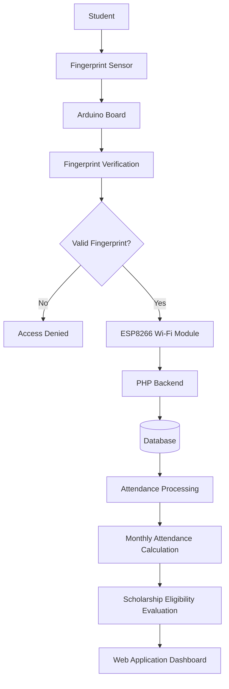

# 🎓 Student Fingerprint Attendance & Scholarship Eligibility Management System

An Arduino-based biometric student attendance management system designed for Sri Lankan public universities. The system uses fingerprint authentication to automate student attendance tracking, calculate monthly attendance percentages, and determine eligibility for government student allowances such as **Mahapola and Bursary scholarships**.

  
   
  <b>▶ Watch the Project Demonstration on YouTube</b>

---

## 📌 Project Overview

Student attendance plays an important role in determining eligibility for financial assistance programs in Sri Lankan public universities.

However, traditional attendance management methods can be time-consuming, difficult to maintain, and challenging to monitor accurately. Students also need a reliable way to track their monthly attendance and understand whether they meet the attendance requirements for financial allowances.

To address this problem, I developed a **Fingerprint-Based Student Attendance and Scholarship Eligibility Management System**.

The system uses biometric fingerprint authentication to record student attendance automatically. It processes attendance records, calculates monthly attendance percentages, and provides information about students' eligibility for Mahapola and Bursary allowances based on configured attendance requirements.

The solution combines embedded hardware, biometric authentication, and a web-based application to provide a more reliable and efficient attendance management process.

## 🎯 Project Objectives

- Automate student attendance recording using fingerprint authentication.
- Minimize manual attendance recording and human errors.
- Maintain centralized student attendance records.
- Calculate monthly attendance percentages automatically.
- Identify students who meet the configured attendance requirements for Mahapola and Bursary allowances.
- Provide an accessible web interface to manage and monitor attendance information.
- Improve transparency in student attendance monitoring and scholarship eligibility management.

## ✨ Key Features

### 🔐 Biometric Fingerprint Authentication
- Uses a fingerprint sensor to identify and authenticate students.
- Eliminates the need for traditional manual attendance marking.
- Helps prevent proxy attendance through biometric verification.

### 📊 Automated Attendance Management
- Automatically records attendance after successful fingerprint authentication.
- Maintains student attendance information in the backend database.
- Provides a structured approach to managing attendance records.

### 📅 Monthly Attendance Calculation
- Calculates student attendance percentages for each month.
- Tracks attendance against the applicable attendance requirements.
- Provides attendance information to support scholarship eligibility decisions.

### 🎓 Mahapola & Bursary Eligibility Monitoring
- Evaluates monthly attendance percentages against configured eligibility criteria.
- Identifies students who meet the required attendance percentage.
- Helps university administrators monitor attendance-related scholarship eligibility.

### 🌐 Web-Based Management System
- Provides a web interface for accessing attendance information.
- Uses PHP for backend processing.
- Uses HTML, CSS, and JavaScript for the frontend.

### 📡 Wireless Hardware Communication
- Uses an ESP8266 Wi-Fi module to enable communication between the Arduino-based fingerprint system and the backend application.
- Transfers attendance-related information to the web application.

## 🏗️ System Architecture

The system consists of three main components:

1. **Hardware Layer** – Captures fingerprints and performs student identification.
2. **Communication Layer** – Uses ESP8266 to establish wireless communication.
3. **Application Layer** – Processes attendance records, stores data, calculates attendance percentages, and manages eligibility information.

### System Workflow

## 🔧 Hardware Components

| Component | Purpose |
|---|---|
| Arduino Board | Controls the fingerprint attendance hardware and processes sensor communication. |
| Fingerprint Sensor | Captures and verifies student fingerprints. |
| ESP8266 Wi-Fi Module | Provides wireless connectivity for sending attendance information to the backend. |

## 💻 Technologies Used

### Backend
- PHP

### Frontend
- HTML5
- CSS3
- JavaScript

### Embedded System / Hardware Programming
- C++
- Arduino

### Hardware
- Arduino Development Board
- Fingerprint Sensor
- ESP8266 Wi-Fi Module

## ⚙️ How the System Works

1. A student places their finger on the fingerprint sensor.
2. The fingerprint sensor captures the fingerprint and checks it against previously registered fingerprints.
3. The Arduino board processes the fingerprint identification result.
4. If the fingerprint is successfully verified, the system identifies the corresponding student.
5. The ESP8266 Wi-Fi module establishes communication with the backend application.
6. The PHP backend receives and processes the attendance information.
7. The attendance record is stored in the database.
8. The application calculates the student's monthly attendance percentage.
9. The system evaluates the attendance percentage against the configured Mahapola and Bursary eligibility requirements.
10. Attendance and eligibility information can be viewed through the web application.

## 🎥 Project Demonstration

Watch the complete project demonstration:

🔗 **YouTube:** https://youtu.be/XxqSSQNsHlI

## 🌍 Real-World Impact

This project was developed to address a practical challenge faced by students and universities in Sri Lanka.

By combining biometric authentication with automated attendance management, the system aims to:

- Reduce manual attendance management.
- Improve the accuracy and reliability of attendance records.
- Make monthly attendance information easier to access.
- Help students monitor their attendance and scholarship eligibility.
- Support university administrators in managing attendance-related financial assistance requirements.

## 🚀 Future Improvements

Some potential enhancements for the system include:

- Real-time attendance notifications.
- Student mobile application.
- Advanced attendance analytics and reporting.
- Multi-department and multi-faculty support.
- Cloud-based attendance management.
- Integration with university student information systems.
- Enhanced security and access control.

## 👨‍💻 Developer

Developed as a student project to solve a real-world problem in Sri Lankan public universities by combining embedded systems, biometric authentication, and web application development.

**Technologies:** C++, Arduino, PHP, HTML, CSS, JavaScript, ESP8266.

---

⭐ If you find this project interesting, consider giving this repository a star!

